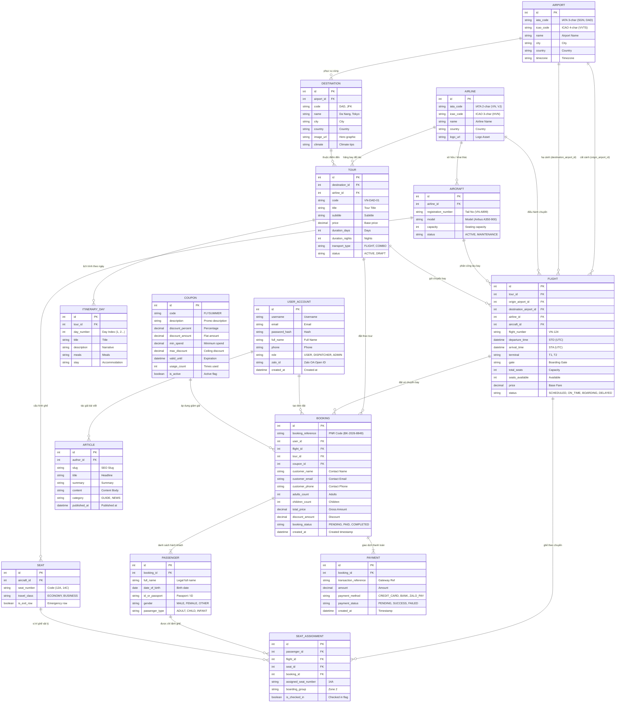

# ✈️ Airport Management & Booking System

> **Enterprise-Grade Aviation Operations & Commercial Flight Booking Platform**  
> Built with **ASP.NET Core 8 Web API**, **Entity Framework Core 8 (Code-First)**, **React 19**, **TypeScript**, and **Vite 6**.  
> Styled strictly under the **Swiss Modernism 2.0** design philosophy.

---

## 📑 Table of Contents

- [1. Executive Overview](#1-executive-overview)
- [2. System Architecture](#2-system-architecture)
- [3. Complete Technology Stack](#3-complete-technology-stack)
- [4. Database Architecture & ERD](#4-database-architecture--erd)
- [5. Backend Architecture (ASP.NET Core & EF Core)](#5-backend-architecture-aspnet-core--ef-core)
- [6. Front-End Portals & User Experience](#6-front-end-portals--user-experience)
- [7. Design System: Swiss Modernism 2.0](#7-design-system-swiss-modernism-20)
- [8. Repository Directory Structure](#8-repository-directory-structure)
- [9. Quick Start & Installation](#9-quick-start--installation)
- [10. Industry Compliance & Business Rules](#10-industry-compliance--business-rules)
- [11. Complete Documentation Index](#11-complete-documentation-index)

---

## 1. Executive Overview

The **Airport Management & Booking System** is an end-to-end platform bridging two complex domains of the aviation industry:

1. **Airside Flight & Fleet Operations (Back-Office / Dispatch Tier):**  
   Empowers airport dispatchers, air traffic supervisors, and airline operations controllers to manage physical fleet assets, configure seating capacities, schedule flight slots, update real-time Flight Information Display Systems (FIDS), and audit passenger manifests.
2. **Landside Commercial & Booking Services (Customer Experience Tier):**  
   Provides travelers with an ultra-fast, high-aesthetic web application to discover destinations, compare packaged airline tours, select physical aircraft seats, complete multi-passenger bookings with Sabre/Amadeus standard PNR references, redeem promotional coupons, and manage e-tickets.

---

## 2. System Architecture

The solution implements an **N-Tier Clean Architecture** separating concerns across presentation, business services, and database persistence:

```
+----------------------------------------------------------------------------------------------------+
|                                         PRESENTATION TIER                                          |
|                                                                                                    |
|    +------------------------------------------+    +------------------------------------------+    |
|    |      Passenger WebApp (Port 5173)        |    |    Admin Dispatch Portal (Port 5174)     |    |
|    |   React 19 + TypeScript + Tailwind CSS   |    |    FIDS Scheduling + Manifest Controller  |    |
|    +------------------------------------------+    +------------------------------------------+    |
+-------------------------------------------------+--------------------------------------------------+
                                                  | JSON REST APIs / Bearer JWT
                                                  v
+----------------------------------------------------------------------------------------------------+
|                                    ASP.NET CORE 8 WEB API TIER                                     |
|  - RESTful Endpoints (/api/v1/flights, /api/v1/bookings, /api/v1/tours, /api/v1/auth)              |
|  - Role-Based Access Control (RBAC: USER, DISPATCHER, AIRPORT_STAFF, ADMIN)                        |
|  - Swagger / OpenAPI Interactive Documentation                                                     |
|  - Global Exception Handling & Security Middleware                                                 |
+-------------------------------------------------+--------------------------------------------------+
                                                  |
                                                  v
+----------------------------------------------------------------------------------------------------+
|                                    APPLICATION SERVICES LAYER                                      |
|  - Flight Dispatch Service & Slot Assignment    - PNR Reference Generator (Sabre/Amadeus Format)  |
|  - Anti-Overbooking Concurrency Validator       - Fare & Promotion Calculation Engine              |
+-------------------------------------------------+--------------------------------------------------+
                                                  |
                                                  v
+----------------------------------------------------------------------------------------------------+
|                             ENTITY FRAMEWORK CORE 8 (PERSISTENCE)                                  |
|  - AirportDbContext (Code-First Fluent API)     - Generic Repository & Unit of Work Pattern        |
|  - Automatic Migrations & Seeding Engine        - Composite Unique Constraints                     |
+-------------------------------------------------+--------------------------------------------------+
                                                  |
                                                  v
+----------------------------------------------------------------------------------------------------+
|                                          DATABASE STORAGE                                          |
|                Microsoft SQL Server 2022 / PostgreSQL 16 (15 Relational Entities)                  |
+----------------------------------------------------------------------------------------------------+
```

---

## 3. Complete Technology Stack

| Layer | Technology | Version | Purpose |
| :--- | :--- | :--- | :--- |
| **Frontend Framework** | **React** | `19.0.0` | Modern UI with concurrent rendering and hooks |
| **Language (Client)** | **TypeScript** | `5.7.2` | Strict end-to-end type safety |
| **Build & Dev Tool** | **Vite** | `6.2.0` | Sub-second HMR and multi-page application bundling |
| **Styling & CSS** | **Tailwind CSS** | `3.4.17` | Utility-first Swiss Modernism styling system |
| **Icons & Assets** | **Lucide React** | `0.475.0` | Minimalist geometric interface icons |
| **HTTP Client** | **Axios** | `1.7.9` | Interceptor-driven HTTP with JWT injection |
| **Backend Framework** | **ASP.NET Core Web API**| `.NET 8.0` | High-throughput asynchronous REST API |
| **Language (Server)** | **C#** | `12.0` | Strongly typed object-oriented server code |
| **ORM Engine** | **Entity Framework Core** | `8.0.x` | Code-First relational mapping, LINQ queries, and migrations |
| **Database Server** | **SQL Server / PostgreSQL**| `2022 / 16` | ACID-compliant relational data storage |
| **API Documentation** | **Swagger / OpenAPI** | `6.5.0` | Interactive schema testing and client contract verification |
| **Authentication** | **JWT Bearer + Identity** | `8.0.x` | Stateless token authentication with claims-based RBAC |
| **Aviation Standards**| **IATA / ICAO / PNR** | Industry Std | 3-letter IATA, 4-letter ICAO, 6-char PNR booking codes |

---

## 4. Database Architecture & ERD

The database schema is normalized to **Third Normal Form (3NF)** and consists of **15 entities** with enforced referential integrity.

### 4.1. Visual Entity Relationship Diagram (ERD)



*For complete data dictionary and SQL column specifications, see [docs/DATABASE_ERD.md](file:///d:/Github/fleeforezz/Airport_Management_System/docs/DATABASE_ERD.md).*  
*To view or edit the interactive diagram, open [Airport_Management_System_UML.drawio](file:///d:/Github/fleeforezz/Airport_Management_System/Airport_Management_System_UML.drawio).*

---

## 5. Backend Architecture (ASP.NET Core & EF Core)

The backend provides a scalable, stateless API powered by **Entity Framework Core 8**.

### 5.1. Key EF Core Features & Constraints
- **Code-First DbContext (`AirportDbContext`):** Enforces entity relations, navigational properties, and table naming.
- **Critical Anti-Overbooking Constraint:** A composite unique index on `(FlightId, SeatId)` in `SeatAssignment` guarantees at the database engine level that no two passengers can be issued the same seat on a flight.
- **Unique PNR Generation:** `Booking.BookingReference` has a unique database index to guarantee conflict-free PNR references.
- **Financial Immutability:** `Booking` snapshots the gross `TotalPrice` and `DiscountAmount` at the moment of payment, decoupling historical transactions from future tour price edits.

### 5.2. Core EF Core CLI Commands
```bash
# Add EF Core tooling packages
dotnet add package Microsoft.EntityFrameworkCore.SqlServer
dotnet add package Microsoft.EntityFrameworkCore.Tools
dotnet add package Microsoft.EntityFrameworkCore.Design

# Generate initial migration from entity models
dotnet ef migrations add InitialCreate --project AirportManagement.Infrastructure --startup-project AirportManagement.Api

# Update database schema
dotnet ef database update --project AirportManagement.Infrastructure --startup-project AirportManagement.Api
```

### 5.3. REST API Endpoint Catalog

| Controller | Method | Route | Description |
| :--- | :--- | :--- | :--- |
| `AuthController` | `POST` | `/api/v1/auth/register` | Register new user account |
| `AuthController` | `POST` | `/api/v1/auth/login` | Authenticate and obtain JWT token |
| `FlightsController` | `GET` | `/api/v1/flights` | Search flight slots (origin, dest, date) |
| `FlightsController` | `PATCH`| `/api/v1/flights/{id}/status` | Dispatcher updates FIDS flight status |
| `ToursController` | `GET` | `/api/v1/tours` | List commercial travel packages |
| `ToursController` | `GET` | `/api/v1/tours/{id}` | Tour detail with daily itinerary |
| `DestinationsController`| `GET` | `/api/v1/destinations` | List airport-linked destinations |
| `BookingsController` | `POST` | `/api/v1/bookings` | Create booking, manifest & issue PNR |
| `BookingsController` | `GET` | `/api/v1/bookings/{pnr}` | Query booking status by PNR code |
| `SeatsController` | `GET` | `/api/v1/flights/{id}/seats` | Real-time seat occupancy map |
| `SeatsController` | `POST` | `/api/v1/check-in/select-seat`| Allocate passenger to seat |
| `CouponsController` | `GET` | `/api/v1/coupons/validate/{code}` | Verify coupon validity |
| `ArticlesController` | `GET` | `/api/v1/articles` | Flight tips & travel guides |
| `AnalyticsController`| `GET` | `/api/v1/analytics/dashboard` | Revenue, load factor & FIDS stats |

*For complete implementation details, POCO classes, and configuration snippets, see [docs/BACKEND_API_EFCORE.md](file:///d:/Github/fleeforezz/Airport_Management_System/docs/BACKEND_API_EFCORE.md).*

---

## 6. Front-End Portals & User Experience

The front-end is organized as a unified Vite workspace with **dual entry points**:

```
frontend/
├── index.html            # Entry 1: Passenger Booking WebApp (Port 5173)
├── admin.html            # Entry 2: Airport Dispatch Admin Portal (Port 5174)
├── vite.config.ts        # Client WebApp build configuration
├── vite.admin.config.ts  # Admin Portal build configuration
└── src/
    ├── pages/            # Passenger pages (HomePage, Explore, Tours, Booking, Account)
    ├── components/       # Layout, TourCard, DeparturePicker, GuestCounter, StatusBadge
    ├── admin/            # Dispatch portal (Dashboard, Tours, Flights, Destinations, CMS)
    ├── context/          # AuthContext, BookingDraftContext
    ├── hooks/            # useFetch, useTours, useBookings
    ├── utils/            # axiosInstance, apiPaths, format (currency, time, duration)
    └── styles/           # swiss.css design system tokens
```

### 1. Passenger WebApp (`index.html`)
- **Visual Discovery:** Search flights and tours by airport code, date, and budget.
- **Departure Slot Picker:** Real-time selection of departure dates and flight times.
- **Seat Allocation Map:** Interactive aircraft seating selector with cabin classes (First, Business, Economy) and exit-row flags.
- **Booking Review & Checkout:** Guest or authenticated booking, coupon redemption, multi-passenger manifest inputs, and instant PNR issuance.

### 2. Airport Dispatch Admin Portal (`admin.html`)
- **Live FIDS Monitor:** Real-time Flight Information Display Board with status toggles (`SCHEDULED`, `ON_TIME`, `BOARDING`, `DELAYED`, `CANCELLED`).
- **Tour & Flight Dispatcher:** Create and manage scheduled flight departure slots, assign aircraft tail numbers, terminals, and gates.
- **Booking & Manifest Manager:** Search bookings by PNR, inspect passenger manifests, and process check-ins.
- **Content & Voucher CMS:** Manage destination profiles, travel articles, and discount voucher campaigns.

---

## 7. Design System: Swiss Modernism 2.0

The entire UI is built on strict **Swiss Modernism 2.0** design rules (documented in [design-rules/DESIGN.md](file:///d:/Github/fleeforezz/Airport_Management_System/design-rules/DESIGN.md)):

- **Zero Radius:** `rounded-none` / `0px border radius` everywhere. No rounded cards or pill buttons.
- **Flat 2D Architecture:** Absolutely no drop shadows (`box-shadow: none !important;`). Depth is achieved solely through 1px crisp hairlines (`#E5E7EB` / `#000000`).
- **Color Discipline:**
  - `Core Black (#000000)`: Primary typography, active states, borders.
  - `Pure White (#FFFFFF)`: Card and canvas backgrounds.
  - `Light Gray (#F5F5F5)`: Subtle alternating row backgrounds.
  - `Accent Swiss Red (#DC2626)`: High-priority alerts, primary action buttons, active tab indicators.
- **Typography Scale:**
  - `Inter`: Sans-serif for high-legibility display copy.
  - `JetBrains Mono`: Monospace for flight numbers, PNRs, IATA codes, and currency amounts.
  - `label-caps`: Uppercase tracking `0.08em` for section labels and table column headers.

---

## 8. Repository Directory Structure

```
Airport_Management_System/
├── AirportManagementSystem/                # C# Backend Service & Models
│   ├── Models/                            # Domain models (Airport, Airline, Aircraft)
│   ├── Repositories/                      # Data access abstractions
│   ├── Services/                          # Airport service logic
│   └── AirportManagementSystem.csproj     # .NET 8 Project file
│
├── frontend/                              # Frontend React 19 + TypeScript + Vite
│   ├── src/
│   │   ├── admin/                         # Admin Dispatcher Portal pages & components
│   │   ├── components/                    # Swiss UI component library
│   │   ├── context/                       # Global React Contexts
│   │   ├── hooks/                         # Reusable state and data fetching hooks
│   │   ├── pages/                         # Client WebApp pages
│   │   ├── styles/                        # Swiss Modernism 2.0 CSS & tokens
│   │   ├── types/                         # TypeScript interfaces (User, Tour, Flight, Booking)
│   │   └── utils/                         # API paths, formatters, mock data
│   ├── admin.html                         # Admin Dispatch entry
│   ├── index.html                         # Passenger WebApp entry
│   ├── package.json                       # NPM dependencies
│   ├── vite.config.ts                     # Client Vite config
│   └── vite.admin.config.ts               # Admin Vite config
│
├── design-rules/                          # Design System Tokens & Guidelines
│   ├── DESIGN.md                          # Swiss Modernism 2.0 specification
│   ├── UI_COMPONENTS.md                   # DOs and DON'Ts code patterns
│   ├── AIRPORT_DOMAIN_RULES.md            # IATA/ICAO, PNR & flight domain rules
│   └── PROMPT_TEMPLATES.md                # Ready-to-use AI prompts
│
├── docs/                                  # Complete Technical Architecture Documentation
│   ├── DATABASE_ERD.md                    # 15-entity ERD, data dictionary, SQL types
│   └── BACKEND_API_EFCORE.md              # ASP.NET Core & EF Core 8 API guide
│
├── Airport_Management_System_UML.drawio   # Official Draw.io ERD diagram file
├── GEMINI.md                              # AI Agent workspace rules
└── README.md                              # This master document
```

---

## 9. Quick Start & Installation

### 9.1. Prerequisites
- **Node.js**: `v18.0.0` or higher
- **.NET SDK**: `8.0` or higher
- **Database Server**: Microsoft SQL Server (LocalDB, Express, or Docker) or PostgreSQL 15+

### 9.2. Frontend Setup & Run
```bash
# Navigate to frontend directory
cd frontend

# Install dependencies
npm install

# Start the Passenger WebApp (Port 5173)
npm run dev

# Start the Admin Dispatch Portal (Port 5174)
npm run dev:admin

# Build production bundles
npm run build         # Passenger WebApp
npm run build:admin   # Admin Dispatch Portal
```

### 9.3. Backend Setup (ASP.NET Core & EF Core)
```bash
# Navigate to backend directory
cd AirportManagementSystem

# Restore NuGet packages
dotnet restore

# Run Entity Framework Core migrations
dotnet ef database update

# Run the API server (Port 5000 / 5001)
dotnet run
```

---

## 10. Industry Compliance & Business Rules

1. **Airport Code Standards:** All airfields must carry valid 3-letter **IATA** (`SGN`, `DAD`, `HAN`) and 4-letter **ICAO** (`VVTS`, `VVRG`, `VVNB`) codes.
2. **Airline Code Standards:** Airlines must be identified by 2-character **IATA** (`VN`, `VJ`, `QH`) and 3-letter **ICAO** (`HVN`, `VJC`, `BAV`) codes.
3. **Passenger Name Record (PNR):** Generated booking codes follow the 6-to-8 alphanumeric character Sabre/Amadeus standard (`BK-2026-8849`).
4. **Timezone Handling:** All flight schedules (`DepartureTime`, `ArrivalTime`) are stored and computed in **UTC**, converted to local airport timezone only in presentation layers.
5. **Manifest Passenger Classifications:**
   - `ADULT`: Age 12+ (Full seat, standard baggage).
   - `CHILD`: Age 2–11 (Full seat, reduced fare).
   - `INFANT`: Age <2 (Lap child, zero or minimal seat charge).

---

## 11. Complete Documentation Index

| Document | Path | Description |
| :--- | :--- | :--- |
| **Database ERD & Schema** | [docs/DATABASE_ERD.md](file:///d:/Github/fleeforezz/Airport_Management_System/docs/DATABASE_ERD.md) | Comprehensive 15-entity dictionary, 3NF normalization & relationships |
| **Backend & EF Core Architecture**| [docs/BACKEND_API_EFCORE.md](file:///d:/Github/fleeforezz/Airport_Management_System/docs/BACKEND_API_EFCORE.md) | ASP.NET Core Web API, EF Core models, DbContext, Migrations & REST endpoints |
| **Interactive Visual Diagram** | [Airport_Management_System_UML.drawio](file:///d:/Github/fleeforezz/Airport_Management_System/Airport_Management_System_UML.drawio) | Visual draw.io ERD diagram file for VS Code Draw.io extension |
| **Swiss Modernism 2.0 Design** | [design-rules/DESIGN.md](file:///d:/Github/fleeforezz/Airport_Management_System/design-rules/DESIGN.md) | Official design tokens, spacing scale, colors, and typography |
| **Component Code Patterns** | [design-rules/UI_COMPONENTS.md](file:///d:/Github/fleeforezz/Airport_Management_System/design-rules/UI_COMPONENTS.md) | DOs and DON'Ts code patterns for frontend components |
| **Airport Domain Rules** | [design-rules/AIRPORT_DOMAIN_RULES.md](file:///d:/Github/fleeforezz/Airport_Management_System/design-rules/AIRPORT_DOMAIN_RULES.md) | IATA, ICAO, PNR, flight rules and manifest specifications |
| **AI Prompt Templates** | [design-rules/PROMPT_TEMPLATES.md](file:///d:/Github/fleeforezz/Airport_Management_System/design-rules/PROMPT_TEMPLATES.md) | Ready-to-use prompt templates for code generation |

---

## 📄 License
This project is proprietary software developed for educational and enterprise airport operations training. All rights reserved.
