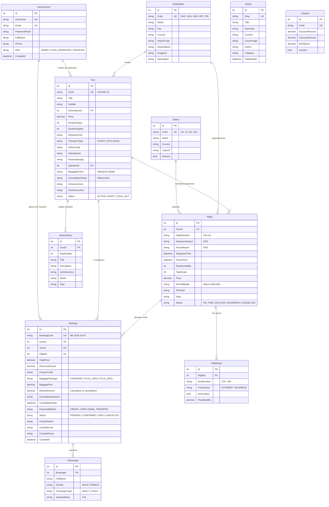

# ✈️ AeroFlight Expeditions — Flight-Exclusive Tour & Aviation Booking Platform

> **Nền tảng Đặt Lịch Tour Du Lịch Độc Quyền Hàng Không (Flight-Exclusive Travel & Tour Booking Platform)**  
> Phát triển trên nền tảng **ASP.NET Core (.NET 8/9 Web API)**, **Entity Framework Core (Code-First)**, **PostgreSQL**, **React 18/19**, **TypeScript**, và **Vite**.  
> Thiết kế giao diện tuân thủ triệt để ngôn ngữ thị giác **Swiss Modernism 2.0** (Zero Radius, Hairlines, Flat 2D, Inter & JetBrains Mono).

---

## 📑 Mục Lục Tài Liệu (Table of Contents)

- [1. Giới Thiệu Tổng Quan & Chuyển Đổi Nghiệp Vụ](#1-giới-thiệu-tổng-quan--chuyển-đổi-nghiệp-vụ)
- [2. Nghiệp Vụ Cốt Lõi & Quy Tắc Vận Hành (Domain Rules)](#2-nghiệp-vụ-cốt-lõi--quy-tắc-vận-hành-domain-rules)
  - [2.1 Phương Tiện Di Chuyển Độc Quyền Hàng Không](#21-phương-tiện-di-chuyển-độc-quyền-hàng-không)
  - [2.2 Nghiệp Vụ Phụ Thu Hành Lý (Baggage Surcharges)](#22-nghiệp-vụ-phụ-thu-hành-lý-baggage-surcharges)
  - [2.3 Chính Sách Hủy Tour & Hoàn Tiền Tự Động (Cancellation & Refund Policy)](#23-chính-sách-hủy-tour--hoàn-tiền-tự-động-cancellation--refund-policy)
  - [2.4 Mô Hình Phân Quyền Người Dùng 3 Cấp Độ (3-Tier RBAC)](#24-mô-hình-phân-quyền-người-dùng-3-cấp-độ-3-tier-rbac)
- [3. Kiến Trúc Hệ Thống (System Architecture)](#3-kiến-trúc-hệ-thống-system-architecture)
- [4. Ngăn Xếp Công Nghệ (Technology Stack)](#4-ngăn-xếp-công-nghệ-technology-stack)
- [5. Thiết Kế Cơ Sở Dữ Liệu & ERD (Entity Relationship Diagram)](#5-thiết-kế-cơ-sở-dữ-liệu--erd-entity-relationship-diagram)
- [6. Danh Mục REST API (API Endpoints Directory)](#6-danh-mục-rest-api-api-endpoints-directory)
- [7. Hệ Thống Thiết Kế: Swiss Modernism 2.0](#7-hệ-thống-thiết-kế-swiss-modernism-20)
- [8. Cấu Trúc Mã Nguồn Dự Án (Project Structure)](#8-cấu-trúc-mã-nguồn-dự-án-project-structure)
- [9. Hướng Dẫn Cài Đặt & Khởi Chạy (Setup & Execution Guide)](#9-hướng-dẫn-cài-đặt--khởi-chạy-setup--execution-guide)
- [10. Tài Khoản Kiểm Thử Mặc Định (Demo Test Matrix)](#10-tài-khoản-kiểm-thử-mặc-định-demo-test-matrix)

---

## 1. Giới Thiệu Tổng Quan & Chuyển Đổi Nghiệp Vụ

Dự án **AeroFlight Expeditions** là nền tảng thương mại điện tử chuyên biệt hóa trong lĩnh vực du lịch lữ hành cao cấp, trong đó **phương tiện vận chuyển duy nhất và bắt buộc xuyên suốt toàn bộ hành trình là Hàng Không (Aviation Exclusive)**.

Hệ thống kết nối trực tiếp ba thực thể chính:
1. **Khách du lịch (Traveler):** Trải nghiệm tìm kiếm, lựa chọn gói tour bay cao cấp, đặt chỗ bay, mua thêm gói hành lý ký gửi, thanh toán và quản lý vé điện tử minh bạch.
2. **Đơn vị điều hành tour (Tour Operator):** Quản lý toàn bộ vòng đời tour du lịch (thêm, sửa, xóa), cấu hình chính sách hành lý, chính sách hủy tour, liên kết với các hãng hàng không được hỗ trợ và theo dõi danh sách hành khách (PNR Manifest).
3. **Quản trị viên hệ thống (Administrator):** Quản trị tài khoản người dùng, giám sát các hãng hàng không đối tác, điều phối chi tiết các slot chuyến bay, và phát hành các bài viết hướng dẫn cẩm nang du lịch.

---

## 2. Nghiệp Vụ Cốt Lõi & Quy Tắc Vận Hành (Domain Rules)

### 2.1 Phương Tiện Di Chuyển Độc Quyền Hàng Không
- Mọi gói tour trong hệ thống đều định danh loại hình vận tải là `FLIGHT_EXCLUSIVE`.
- Mỗi tour luôn gắn liền với mã hãng bay (`AirlineCode`), thông tin chuyến bay cụ thể, sân bay xuất phát (`Origin Airport - IATA`), sân bay đến (`Destination Airport - IATA`) và sơ đồ phân bổ vị trí ghế ngồi khoang khách (`Window / Aisle / Middle`).

### 2.2 Nghiệp Vụ Phụ Thu Hành Lý (Baggage Surcharges)
Để đáp ứng tiêu chuẩn khai thác thương mại hàng không, hệ thống áp dụng cơ chế quản lý hành lý minh bạch:
- **Tiêu chuẩn mặc định miễn phí (Base Inclusion):** Mọi hành khách đều được bao gồm sẵn **1 kiện hành lý xách tay 7kg** + **1 kiện hành lý ký gửi tiêu chuẩn 20kg**.
- **Các gói phụ thu hành lý lựa chọn thêm (Add-on Baggage Packages):**
  | Mã Gói | Tên Gói Hành Lý | Trọng Lượng Bổ Sung | Mức Phụ Thu | Mô Tả |
  | :--- | :--- | :--- | :--- | :--- |
  | `STANDARD` | Gói Tiêu Chuẩn | 0 kg | **$0.00** | 7kg xách tay + 20kg ký gửi (Đã bao gồm trong giá vé) |
  | `PLUS_10KG` | Thêm 10kg Ký Gửi | +10 kg | **+$25.00** | Nâng tổng hành lý ký gửi lên 30kg |
  | `PLUS_20KG` | Thêm 20kg Ký Gửi | +20 kg | **+$45.00** | Nâng tổng hành lý ký gửi lên 40kg |
  | `PLUS_30KG` | Thêm 30kg Hàng Nặng | +30 kg | **+$65.00** | Nâng tổng hành lý ký gửi lên 50kg |
  | `SPORTS_EQUIPMENT`| Dụng Cụ Thể Thao | Trọn bộ thiết bị | **+$50.00** | Dành cho túi Golf, ván lướt sóng, ván trượt tuyết |

- **Quy tắc tính toán & lưu trữ:** Mức phụ thu hành lý được cộng trực tiếp vào `TotalPrice` trong đơn đặt chỗ, đồng thời lưu trữ chi tiết mã gói `BaggagePackage` và số tiền `BaggageFee` vào bảng `Bookings` trong cơ sở dữ liệu.

### 2.3 Chính Sách Hủy Tour & Hoàn Tiền Tự Động (Cancellation & Refund Policy)
Chính sách hủy tour được quy định công khai tại trang chi tiết tour và bắt buộc khách hàng phải xác nhận đồng ý tại trang Checkout:

```
                  THỜI ĐIỂM HỦY TOUR SO VỚI NGÀY KHỞI HÀNH (DEPARTURE DATE)
                                             |
     +-------------------+-------------------+-------------------+-------------------+
     |                   |                   |                   |                   |
≥ 15 Ngày Trước Giờ Bay  7 - 14 Ngày Trước   3 - 6 Ngày Trước   < 48 Giờ Trước Giờ Bay
     |                   |                   |                   |                   |
     v                   v                   v                   v
Hoàn Tiền 100%       Hoàn Tiền 70%       Hoàn Tiền 40%       Hoàn Tiền 0%
(Phí phạt: 0%)       (Phí phạt: 30%)     (Phí phạt: 60%)     (Không hoàn lại)
```

- **Quy tắc giải phóng chỗ:** Khi hủy tour thành công, trạng thái đơn chuyển sang `CANCELLED`, hệ thống tự động ghi nhận `CancellationDate`, `CancellationReason`, số tiền hoàn lại `RefundAmount`, đồng thời hoàn trả số lượng ghế ngồi về lại kho chỗ trống của chuyến bay (`SeatsAvailable`).

### 2.4 Mô Hình Phân Quyền Người Dùng 3 Cấp Độ (3-Tier RBAC)

Hệ thống phân tách quyền hạn rành mạch giữa 3 nhóm người dùng:

| Quyền Hạn / Tính Năng | 👑 ADMIN (Quản Trị Viên) | 🏢 TOUR OPERATOR (Điều Hành Tour) | 🎒 TRAVELER (Khách Du Lịch) |
| :--- | :---: | :---: | :---: |
| **Đăng ký tài khoản hệ thống** | Được chỉ định / Cấp quyền | ✅ Đăng ký trực tiếp role `TOUR_OPERATOR` | ✅ Đăng ký trực tiếp role `TRAVELER` |
| **Tìm kiếm & Đặt tour hàng không** | Có thể xem | Có thể xem | ✅ Đặt tour, chọn ghế, chọn hành lý |
| **Hủy tour & Nhận tiền hoàn lại** | Giám sát | Giám sát | ✅ Hủy theo khung chính sách |
| **Thêm / Sửa / Xóa Tour Du Lịch** | ❌ **Không được phép can thiệp** | ✅ **Toàn quyền quản lý Tour** | ❌ Không có quyền |
| **Thiết lập chính sách hành lý & hủy** | ❌ Không can thiệp | ✅ Toàn quyền cấu hình | ❌ Chỉ xem |
| **Quản lý danh sách Hãng Hàng Không** | ✅ Quản lý danh mục hãng bay | ✅ Quản lý hãng bay hỗ trợ | ❌ Chỉ xem |
| **Quản lý Slot & Chuyến Bay (FIDS)** | ✅ Quản lý chi tiết chuyến bay | ✅ Quản lý lịch bay của tour | ❌ Chỉ xem |
| **Quản lý Tài Khoản & Phân Quyền** | ✅ Toàn quyền (Đổi Role, Xóa User) | ❌ Không có quyền | ❌ Chỉ quản lý Profile cá nhân |
| **Đăng bài viết & Cẩm nang du lịch** | ✅ Toàn quyền soạn thảo & xuất bản | ❌ Không có quyền | ❌ Chỉ đọc bài viết |
| **Xem Danh Sách Khách Đặt Vé (PNR)** | ✅ Giám sát tổng thể | ✅ Xem chi tiết khách đặt tour của mình | ❌ Chỉ xem vé của mình |

### 2.5 Quy Chế Bảo Vệ & Phân Luồng Cổng Truy Cập (Portal Access Security Gates)

Hệ thống thiết lập rào chắn bảo vệ phân quyền (RBAC Route Guard & Access Control):
1. **Admin Portal (`/admin` hoặc `admin.html?mode=admin`):**
   - **Chỉ duy nhất tài khoản có vai trò `ADMIN`** mới được phép truy cập.
   - Nếu chưa đăng nhập: Hệ thống chuyển hướng yêu cầu xác thực (`401 Unauthorized`).
   - Nếu người dùng đăng nhập bằng tài khoản `TOUR_OPERATOR`: Hệ thống chặn quyền và hiển thị thông báo yêu cầu tài khoản Administrator.
   - Nếu là `TRAVELER`: Chặn truy cập tuyệt đối (`403 Forbidden`).
2. **Operation Portal (`/operations` hoặc `admin.html?mode=operator`):**
   - **Chỉ duy nhất tài khoản có vai trò `TOUR_OPERATOR`** mới được phép truy cập.
   - Quản lý vòng đời tour, cấu hình chính sách hành lý & hủy tour, kết nối hãng bay đối tác.
   - Nếu là `TRAVELER`: Chặn truy cập tuyệt đối (`403 Forbidden`).
3. **Cổng Khách Hàng (Passenger WebApp - `/`, `/tours`, `/booking/*`):**
   - Dành cho **Traveler** trải nghiệm dịch vụ. Khách hàng chỉ có quyền xem danh mục, đặt tour bay độc quyền, phân bổ ghế ngồi, chọn mua gói phụ thu hành lý và thực hiện thanh toán PNR. Khách hàng tuyệt đối không có quyền can thiệp vào bất kỳ cổng quản trị nào.

---

## 3. Kiến Trúc Hệ Thống (System Architecture)

Hệ thống được thiết kế theo chuẩn **Clean Architecture (N-Tier Enterprise Architecture)** với ASP.NET Core và PostgreSQL:

```
+----------------------------------------------------------------------------------------------------+
|                                         PRESENTATION TIER                                          |
|                                                                                                    |
|    +------------------------------------------+    +------------------------------------------+    |
|    |      Passenger WebApp (Port 5000/5173)   |    |   Admin & Tour Operator Portal (5174)    |    |
|    |   React 18 + TypeScript + Tailwind CSS   |    |    RBAC Switcher + Flight Catalog Manager|    |
|    +------------------------------------------+    +------------------------------------------+    |
+-------------------------------------------------+--------------------------------------------------+
                                                  | JSON REST APIs / Bearer JWT
                                                  v
+----------------------------------------------------------------------------------------------------+
|                                    ASP.NET CORE WEB API LAYER                                      |
|  - API.Controllers: Tours, Bookings, Airlines, Users, Departures, Destinations, Articles, Coupons   |
|  - Swagger / OpenAPI UI (/swagger)                                                                 |
|  - Global Exception Handling & CORS Middleware                                                      |
+-------------------------------------------------+--------------------------------------------------+
                                                  |
                                                  v
+----------------------------------------------------------------------------------------------------+
|                                    APPLICATION SERVICES LAYER                                      |
|  - TourService (CRUD, Inclusions/Exclusions, Baggage & Cancellation Policy mapping)               |
|  - BookingService (Automated Tiered Refund Calculation, Baggage Fee Engine, Seat Release)         |
|  - AirlineService & UserService (Identity Management, RBAC role updates)                           |
+-------------------------------------------------+--------------------------------------------------+
                                                  |
                                                  v
+----------------------------------------------------------------------------------------------------+
|                                  DOMAIN LAYER (ENTERPRISE CORE)                                    |
|  - Entities: Tour, ItineraryDay, Booking, Passenger, Airline, Flight, UserAccount, Article, etc.  |
|  - Domain Rules: TransportType = "FLIGHT_EXCLUSIVE", Precision Configuration                       |
+-------------------------------------------------+--------------------------------------------------+
                                                  |
                                                  v
+----------------------------------------------------------------------------------------------------+
|                            INFRASTRUCTURE LAYER (DATA PERSISTENCE)                                 |
|  - AirportDbContext (Npgsql PostgreSQL Provider)                                                   |
|  - Repository<T> Pattern & Unit of Work                                                            |
|  - DbInitializer (Auto-Seeding Admin, Tour Operator, Traveler, Airlines, Flights, Tours)          |
+-------------------------------------------------+--------------------------------------------------+
                                                  |
                                                  v
+----------------------------------------------------------------------------------------------------+
|                                         POSTGRESQL DATABASE                                        |
|                   Remote PostgreSQL Database Cluster (Tables, Foreign Keys, Indexes)               |
+----------------------------------------------------------------------------------------------------+
```

---

## 4. Ngăn Xếp Công Nghệ (Technology Stack)

| Phân Vùng | Công Nghệ | Phiên Bản | Mục Đích Sử Dụng |
| :--- | :--- | :--- | :--- |
| **Backend Framework** | **ASP.NET Core Web API** | `.NET 8.0 / 9.0` | Cung cấp RESTful API tốc độ cao, đa luồng |
| **ORM / Data Access** | **Entity Framework Core** | `8.0 / 9.0` | Code-First Mapping, Migration tự động, LINQ queries |
| **Cơ Sở Dữ Liệu** | **PostgreSQL** | `15+ / 16` | Cơ sở dữ liệu quan hệ ACID tiêu chuẩn doanh nghiệp |
| **Thư Viện Kết Nối DB**| **Npgsql.EntityFrameworkCore** | `8.0+` | PostgreSQL driver tối ưu cho EF Core |
| **API Documentation** | **Swashbuckle (Swagger UI)**| `6.5.0` | Tài liệu hóa và giao diện thử nghiệm API tương tác |
| **Mã Hóa & Mật Khẩu** | **BCrypt.Net-Next** | `4.0.3` | Băm mật khẩu người dùng với muối an toàn cao |
| **Frontend Framework** | **React** | `18.3 / 19.0` | Thư viện xây dựng giao diện người dùng theo component |
| **Ngôn Ngữ Client** | **TypeScript** | `5.7.2` | Đảm bảo an toàn kiểu dữ liệu từ đầu đến cuối |
| **Build & Bundler Tool**| **Vite** | `6.2.0` | Khởi động HMR siêu tốc và hỗ trợ xuất bản Multi-App |
| **CSS & Design System**| **Tailwind CSS** | `3.4.17` | Hiện thực hóa phong cách **Swiss Modernism 2.0** |
| **HTTP Client** | **Axios** | `1.7.9` | Giao tiếp API với interceptors tự động |

---

## 5. Thiết Kế Cơ Sở Dữ Liệu & ERD (Entity Relationship Diagram)

Sơ đồ quan hệ thực thể (ERD) thể hiện đầy đủ cấu trúc quan hệ giữa các thực thể cốt lõi:



---

## 6. Danh Mục REST API (API Endpoints Directory)

Hệ thống cung cấp hệ thống API đồng bộ được cấu trúc rõ ràng:

### 6.1 Authentication & Profile (`/api/Auth`)
- `POST /api/Auth/register`: Đăng ký tài khoản mới. Hỗ trợ truyền `role`: `"TRAVELER"` hoặc `"TOUR_OPERATOR"`.
- `POST /api/Auth/login`: Đăng nhập hệ thống bằng email và mật khẩu, trả về JWT Token và thông tin User.
- `GET /api/Auth/me`: Lấy thông tin tài khoản hiện tại đang đăng nhập.

### 6.2 Tour Operations (`/api/Tours`)
- `GET /api/Tours`: Lấy danh sách tour độc quyền hàng không (hỗ trợ lọc theo từ khóa `search` và `destinationId`).
- `GET /api/Tours/{id}`: Xem chi tiết tour (bao gồm lịch trình, chính sách hành lý, chính sách hủy tour).
- `GET /api/Tours/{id}/departures`: Lấy danh sách các slot chuyến bay khởi hành tương ứng của tour.
- `POST /api/Tours`: **[Tour Operator Only]** Tạo mới gói tour du lịch bay.
- `PUT /api/Tours/{id}`: **[Tour Operator Only]** Chỉnh sửa thông tin tour, lịch trình và chính sách.
- `DELETE /api/Tours/{id}`: **[Tour Operator Only]** Xóa tour khỏi danh mục khai thác.

### 6.3 Flight Bookings & Refund (`/api/Bookings`)
- `POST /api/Bookings`: Tạo đơn đặt chỗ mới, bao gồm chọn ghế, gói phụ thu hành lý (`BaggagePackage`, `BaggageFee`).
- `GET /api/Bookings`: Lấy danh sách tất cả các đơn đặt chỗ (Dành cho Quản trị viên và Tour Operator theo dõi Manifest).
- `GET /api/Bookings/my`: Lấy danh sách đơn đặt tour của cá nhân khách hàng đang đăng nhập.
- `GET /api/Bookings/{referenceOrId}`: Tra cứu vé điện tử theo mã PNR (`bookingCode`) hoặc ID.
- `POST /api/Bookings/{id}/cancel`: **[Traveler/Operator]** Hủy đơn đặt tour. Tự động áp dụng công thức hoàn tiền theo chính sách và giải phóng ghế ngồi.
- `PATCH /api/Bookings/{id}/status`: Cập nhật trạng thái vé (`PAID`, `CONFIRMED`, `CANCELLED`).

### 6.4 Airline Directory (`/api/Airlines`)
- `GET /api/Airlines`: Lấy danh mục tất cả các hãng hàng không đối tác đang hoạt động.
- `GET /api/Airlines/{id}`: Lấy chi tiết thông tin một hãng hàng không.
- `POST /api/Airlines`: **[Admin / Tour Operator]** Đăng ký thêm hãng hàng không đối tác mới.
- `PUT /api/Airlines/{id}`: **[Admin / Tour Operator]** Cập nhật thông tin hãng hàng không.
- `DELETE /api/Airlines/{id}`: **[Admin]** Xóa hãng hàng không khỏi hệ thống.

### 6.5 User Identity & RBAC (`/api/Users`)
- `GET /api/Users`: **[Admin Only]** Lấy danh sách toàn bộ người dùng trong hệ thống kèm thông tin vai trò.
- `PATCH /api/Users/{id}/role`: **[Admin Only]** Cập nhật vai trò người dùng (`ADMIN`, `TOUR_OPERATOR`, `TRAVELER`).
- `DELETE /api/Users/{id}`: **[Admin Only]** Thu hồi quyền và xóa tài khoản người dùng.

### 6.6 Flight Matrix & Slots (`/api/Departures`)
- `GET /api/Departures`: Tra cứu toàn bộ chuyến bay và slot cất cánh.
- `GET /api/Departures/{id}`: Xem chi tiết chuyến bay, máy bay khai thác, cửa ra máy bay (`Gate`).
- `GET /api/Departures/{id}/seats`: Lấy sơ đồ ghế ngồi thời gian thực của chuyến bay.
- `PATCH /api/Departures/{id}/status`: **[Admin Only]** Điều chỉnh trạng thái chuyến bay (`ON_TIME`, `DELAYED`, `BOARDING`, `CANCELLED`).

### 6.7 Articles & Directives (`/api/Articles`)
- `GET /api/Articles`: Lấy danh sách các bài viết cẩm nang du lịch và thông tư bay.
- `GET /api/Articles/{slugOrId}`: Đọc bài viết chi tiết theo đường dẫn Slug hoặc ID.

---

## 7. Hệ Thống Thiết Kế: Swiss Modernism 2.0

Toàn bộ giao diện người dùng được xây dựng tuân thủ nghiêm ngặt các nguyên tắc thiết kế **Swiss Modernism 2.0**:
1. **Zero Border Radius (`rounded-none`):** Không sử dụng bất kỳ góc bo tròn nào trên toàn bộ hệ thống (0px border-radius trên nút bấm, thẻ card, input, dialog).
2. **Flat 2D Architecture:** Loại bỏ hoàn toàn đổ bóng (`box-shadow: none !important;`). Sử dụng đường kẻ hairline 1px siêu nét (`#E5E7EB` và `#000000`) để định hình cấu trúc không gian thị giác.
3. **Bảng Màu Kỷ Luật Cao (Strict Color Palette):**
   - **Core Black:** `#000000` (Tiêu đề, nút hành động chính, viền khung).
   - **Pure White:** `#FFFFFF` (Nền thẻ card, nền trang chính).
   - **Light Gray:** `#F5F5F5` (Nền bảng biểu, input nền, dải thông tin phụ).
   - **Accent Swiss Red:** `#DC2626` (Điểm nhấn nhận diện thương hiệu, cảnh báo quan trọng, trạng thái nổi bật).
   - **Status Green:** `#22C55E` (Xác nhận đặt vé thành công, hoàn tiền 100%).
4. **Typography Mạnh Mẽ:** Kết hợp chuẩn mực giữa **Inter** (tiêu đề nội dung) và **JetBrains Mono** (mã PNR, mã chuyến bay, giờ bay UTC, số tiền, thông số kỹ thuật).

---

## 8. Cấu Trúc Mã Nguồn Dự Án (Project Structure)

```
Airport_Management_System/
│
├── backend/                               # ASP.NET Core Clean Architecture Backend
│   ├── Domain/                            # Domain Entities & Business Rules
│   │   ├── Entities/
│   │   │   ├── TourEntities.cs            # Tour, ItineraryDay (FLIGHT_EXCLUSIVE)
│   │   │   ├── FlightAndBookingEntities.cs# Booking (BaggagePackage, RefundAmount), UserAccount
│   │   │   └── AirportEntities.cs         # Airline, Flight, FlightSeat, Destination, Article
│   │   └── Domain.csproj
│   ├── Application/                       # DTOs, Business Services & Interfaces
│   │   ├── DTOs/                          # AuthDtos, FlightAndTourDtos, RemainingDtos
│   │   ├── Interfaces/                    # ITourService, IBookingService, IAirlineService, IUserService
│   │   ├── Services/                      # TourService, BookingService, AirlineService, AuthService
│   │   └── Application.csproj
│   ├── Infrastructure/                    # Database Persistence & Repositories
│   │   ├── Data/
│   │   │   ├── AirportDbContext.cs        # EF Core DbContext with Precision mapping
│   │   │   └── DbInitializer.cs           # Seed Data (Admin, Tour Operator, Traveler)
│   │   ├── Repositories/                  # Generic Repository Implementation
│   │   └── Infrastructure.csproj
│   └── API/                               # Web API Host & Controllers
│       ├── Controllers/                   # ToursController, BookingsController, AirlinesController, UsersController...
│       ├── Program.cs                     # DI Registrations, CORS, Authentication
│       └── appsettings.json               # PostgreSQL Connection String
│
├── frontend/                              # React 18/19 + TypeScript + Vite 6
│   ├── src/
│   │   ├── admin/                         # Portal Điều Hành (Admin & Tour Operator)
│   │   │   ├── components/                # Sidebar (RBAC Switcher), Drawer, Table, ImageUploader
│   │   │   ├── pages/                     # TourPage (CRUD), AirlinesPage, UsersPage, BookingPage
│   │   │   ├── App.tsx                    # Shell điều phối tab theo vai trò đăng nhập
│   │   │   └── main.tsx
│   │   ├── components/                    # Passenger Components (PriceBreakdown, Header, Footer)
│   │   ├── context/                       # AuthContext, BookingDraftContext (Baggage calculations)
│   │   ├── pages/
│   │   │   ├── auth/                      # LoginPage (Đăng nhập, Đăng ký chọn Role Traveler/Operator)
│   │   │   ├── booking/                   # Checkout (Baggage Add-on, Policy Acceptance), Detail (Refund)
│   │   │   ├── tours/                     # TourDetailPage (Baggage & Refund Policy tables), TourListPage
│   │   │   └── HomePage.tsx               # Hero Section & Quick Flight Search Engine
│   │   ├── services/api.ts                # Axios API Services (tourApi, bookingApi, airlineApi, userApi)
│   │   ├── types/index.ts                 # TypeScript Data Contracts
│   │   └── utils/                         # Formatters, Axios Instances, Mock Fallbacks
│   ├── package.json
│   ├── vite.config.ts                     # Main Passenger WebApp config
│   └── vite.admin.config.ts               # Standalone Admin Portal bundle config
│
├── design-rules/                          # Tài liệu quy chuẩn thiết kế Swiss Modernism 2.0
└── README.md                              # Tài liệu kỹ thuật toàn diện dự án
```

---

## 9. Hướng Dẫn Cài Đặt & Khởi Chạy (Setup & Execution Guide)

### 9.1 Yêu Cầu Môi Trường (Prerequisites)
- **.NET SDK 8.0** hoặc **9.0** trở lên.
- **Node.js 18+** hoặc **20+** cùng trình quản lý gói `npm`.
- **PostgreSQL 15+** (Máy chủ cục bộ hoặc Docker / Remote Homelab).

### 9.2 Cấu Hình Cơ Sở Dữ Liệu PostgreSQL
Mở file `backend/API/appsettings.json` và cấu hình chuỗi kết nối:
```json
{
  "ConnectionStrings": {
    "DefaultConnection": "Host=localhost;Port=5432;Database=aeroflight;Username=postgres;Password=YourPassword"
  }
}
```

### 9.3 Chạy Migration & Khởi Động Backend API
Di chuyển vào thư mục backend và khởi chạy dịch vụ:
```powershell
# Chạy migration áp dụng cấu trúc bảng mới vào cơ sở dữ liệu
dotnet ef database update --project backend/Infrastructure --startup-project backend/API

# Khởi chạy Backend Web API (Mặc định lắng nghe tại http://localhost:5000)
dotnet run --project backend/API/API.csproj
```
Khi khởi động lần đầu, `DbInitializer` sẽ tự động tạo bảng và nạp sẵn dữ liệu mẫu (Airlines, Flights, Tours, tài khoản Admin, Tour Operator, Traveler).  
Truy cập tài liệu Swagger UI tại: `http://localhost:5000/swagger`

### 9.4 Khởi Chạy Frontend Client
Mở một cửa sổ dòng lệnh mới và khởi chạy:
```powershell
cd frontend

# Cài đặt các gói phụ thuộc (nếu chưa cài)
npm install

# Khởi chạy máy chủ phát triển Vite
npm run dev
```
- **Passenger Portal (Khách du lịch):** `http://localhost:5173/`
- **Admin & Tour Operator Portal:** `http://localhost:5173/admin.html`

---

## 10. Tài Khoản Kiểm Thử Mặc Định (Demo Test Matrix)

Hệ thống đã chuẩn bị sẵn 3 tài khoản tương ứng với 3 vai trò để kiểm thử toàn diện các luồng nghiệp vụ:

| Vai Trò (Role) | Email Đăng Nhập | Mật Khẩu | Quyền Hạn Thực Tế Trong Hệ Thống |
| :--- | :--- | :--- | :--- |
| 👑 **Administrator** | `admin@airport.gov` | `Admin@123456` | Quản lý người dùng, đổi role RBAC, đăng bài viết cẩm nang, quản lý hãng bay, giám sát flight matrix. *Không được tạo/sửa tour*. |
| 🏢 **Tour Operator** | `operator@aeroops.global` | `Operator@123456` | Thêm, sửa, xóa các gói tour bay, thiết lập chính sách hành lý & hủy tour, quản lý hãng bay hỗ trợ, giám sát PNR manifest. |
| 🎒 **Traveler** | `alex@gmail.com` | `Traveler@123456` | Tìm tour hàng không, chọn chuyến bay, đặt chỗ, chọn gói phụ thu hành lý (+10kg, +20kg...), thực hiện hủy tour nhận hoàn tiền tự động. |

> 💡 *Mẹo kiểm thử:* Bạn có thể đăng ký tài khoản mới trực tiếp tại trang `/auth/login` và tự do chọn vai trò `TRAVELER` hoặc `TOUR_OPERATOR`. Trong giao diện Admin Portal (`/admin.html`), thanh điều hướng bên trái có sẵn bộ nút chuyển nhanh chế độ xem giữa **ADMIN** và **OPERATOR** để kiểm tra giao diện RBAC trực tiếp.

---

© 2026 **AeroFlight Expeditions Platform**. All Rights Reserved.  
Crafted with precision under the **Swiss Modernism 2.0** design philosophy.
