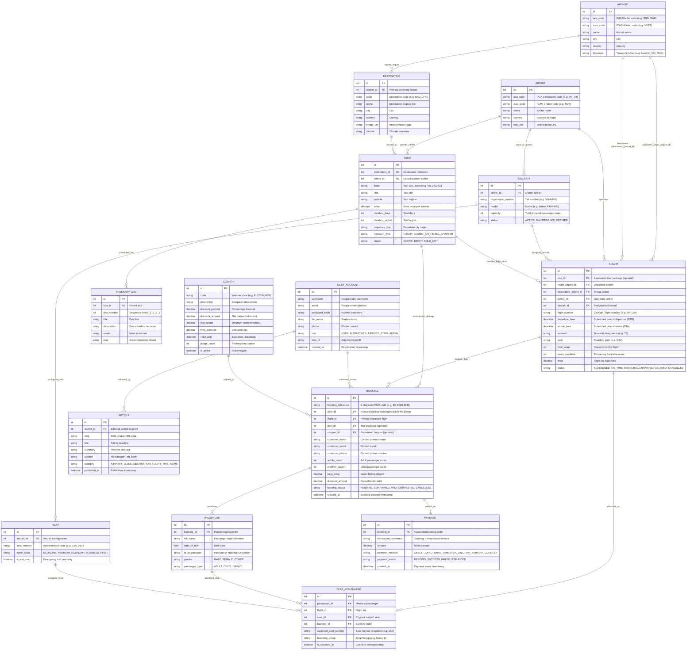

# Airport Management & Booking System — Database Entity Relationship Diagram (ERD)

> **Document Version:** 1.0.0  
> **Architecture Standard:** Swiss Modernism 2.0  
> **Domain Standard:** ICAO / IATA / Sabre-Amadeus PNR Flight Standards  
> **Integration Scope:** C# .NET Backend Engine + React Vite Dispatch & Booking Frontend  

---

## 1. Executive Summary & Domain Scope

The database architecture for the **Airport Management & Booking System** unifies two critical operational domains:

1. **Airside Flight & Fleet Operations (C# .NET Backend Engine):**
   - Manages physical aeronautical assets: Airports (`AIRPORT`), Airlines (`AIRLINE`), Fleet Aircraft (`AIRCRAFT`), Aircraft Seating configurations (`SEAT`), and Scheduled Flight Departures (`FLIGHT`).
2. **Landside Commercial & Booking Management (Web & Dispatch Portal):**
   - Manages customer and dispatcher identities (`USER_ACCOUNT`), Destination portfolios (`DESTINATION`), Flight/Tour packages (`TOUR`), Booking records & PNRs (`BOOKING`), Manifest Passengers (`PASSENGER`), Seat Allocations (`SEAT_ASSIGNMENT`), Financial transactions (`PAYMENT`), Discount promotions (`COUPON`), and Aviation travel guides (`ARTICLE`).

---

## 2. Mermaid Entity Relationship Diagram (ERD)

---

## 3. Detailed Data Dictionary

### 3.1. Fleet & Airfield Operations (Operational Tier)

#### Table: `AIRPORT`
| Column | Type | Constraints | Description |
| :--- | :--- | :--- | :--- |
| `id` | `INT` | PK, AUTO_INCREMENT | Unique identifier for airport |
| `iata_code` | `VARCHAR(3)` | NOT NULL, UNIQUE | 3-letter IATA code (e.g., `SGN`, `DAD`, `HAN`) |
| `icao_code` | `VARCHAR(4)` | NOT NULL, UNIQUE | 4-letter ICAO code (e.g., `VVTS`, `VVRG`) |
| `name` | `VARCHAR(150)` | NOT NULL | Airport display name (e.g., `Tan Son Nhat International Airport`) |
| `city` | `VARCHAR(100)` | NOT NULL | City served |
| `country` | `VARCHAR(100)` | NOT NULL | Country |
| `timezone` | `VARCHAR(50)` | NOT NULL | Standard IANA timezone (e.g., `Asia/Ho_Chi_Minh`) |

#### Table: `AIRLINE`
| Column | Type | Constraints | Description |
| :--- | :--- | :--- | :--- |
| `id` | `INT` | PK, AUTO_INCREMENT | Unique identifier for carrier |
| `iata_code` | `VARCHAR(2)` | NOT NULL, UNIQUE | 2-character IATA code (e.g., `VN`, `VJ`, `QH`) |
| `icao_code` | `VARCHAR(3)` | NOT NULL, UNIQUE | 3-character ICAO code (e.g., `HVN`, `VJC`) |
| `name` | `VARCHAR(100)` | NOT NULL | Full corporate airline name |
| `country` | `VARCHAR(100)` | NOT NULL | Headquarters country |
| `logo_url` | `VARCHAR(255)` | NULL | Vector/PNG airline logo asset |

#### Table: `AIRCRAFT`
| Column | Type | Constraints | Description |
| :--- | :--- | :--- | :--- |
| `id` | `INT` | PK, AUTO_INCREMENT | Aircraft tail unit identifier |
| `airline_id` | `INT` | NOT NULL, FK(`AIRLINE.id`) | Owning/operating airline |
| `registration_number` | `VARCHAR(20)` | NOT NULL, UNIQUE | Tail registration (e.g., `VN-A899`) |
| `model` | `VARCHAR(100)` | NOT NULL | Airframe model (e.g., `Airbus A350-900`) |
| `capacity` | `INT` | NOT NULL | Certified seating capacity |
| `status` | `VARCHAR(20)` | NOT NULL, DEFAULT `'ACTIVE'` | `ACTIVE`, `MAINTENANCE`, `RETIRED` |

#### Table: `SEAT`
| Column | Type | Constraints | Description |
| :--- | :--- | :--- | :--- |
| `id` | `INT` | PK, AUTO_INCREMENT | Unique seat record |
| `aircraft_id` | `INT` | NOT NULL, FK(`AIRCRAFT.id`) | Tail aircraft configuration |
| `seat_number` | `VARCHAR(5)` | NOT NULL | Row & letter (e.g., `12A`, `12B`, `14C`) |
| `travel_class` | `VARCHAR(20)` | NOT NULL | `FIRST`, `BUSINESS`, `PREMIUM_ECONOMY`, `ECONOMY` |
| `is_exit_row` | `BOOLEAN` | NOT NULL, DEFAULT `FALSE` | Extra legroom / emergency exit designation |

#### Table: `FLIGHT`
| Column | Type | Constraints | Description |
| :--- | :--- | :--- | :--- |
| `id` | `INT` | PK, AUTO_INCREMENT | Flight schedule identifier |
| `flight_number` | `VARCHAR(10)` | NOT NULL | Airline code + number (e.g., `VN-124`) |
| `tour_id` | `INT` | NULL, FK(`TOUR.id`) | Optional link to commercial tour package |
| `origin_airport_id` | `INT` | NOT NULL, FK(`AIRPORT.id`) | Origin airfield |
| `destination_airport_id` | `INT` | NOT NULL, FK(`AIRPORT.id`) | Destination airfield |
| `airline_id` | `INT` | NOT NULL, FK(`AIRLINE.id`) | Operating carrier |
| `aircraft_id` | `INT` | NOT NULL, FK(`AIRCRAFT.id`) | Dispatched aircraft |
| `departure_time` | `DATETIME` | NOT NULL | Scheduled Time of Departure (STD) |
| `arrival_time` | `DATETIME` | NOT NULL | Scheduled Time of Arrival (STA) |
| `terminal` | `VARCHAR(10)` | NULL | Airport terminal designation (e.g., `T2`) |
| `gate` | `VARCHAR(10)` | NULL | Boarding gate (e.g., `G12`) |
| `total_seats` | `INT` | NOT NULL | Seating allotment for this leg |
| `seats_available` | `INT` | NOT NULL | Remaining bookable seats |
| `price` | `DECIMAL(12,2)` | NOT NULL | Standard economy fare |
| `status` | `VARCHAR(20)` | NOT NULL, DEFAULT `'SCHEDULED'` | `SCHEDULED`, `ON_TIME`, `BOARDING`, `DEPARTED`, `DELAYED`, `CANCELLED` |

---

### 3.2. Commercial, Catalog & Booking Operations

#### Table: `USER_ACCOUNT`
| Column | Type | Constraints | Description |
| :--- | :--- | :--- | :--- |
| `id` | `INT` | PK, AUTO_INCREMENT | Unique user account |
| `username` | `VARCHAR(50)` | NOT NULL, UNIQUE | Login handle |
| `email` | `VARCHAR(100)` | NOT NULL, UNIQUE | User contact email |
| `password_hash` | `VARCHAR(255)` | NOT NULL | Argon2 / BCrypt hash |
| `full_name` | `VARCHAR(100)` | NOT NULL | Legal or display name |
| `phone` | `VARCHAR(20)` | NULL | Primary contact phone |
| `role` | `VARCHAR(20)` | NOT NULL, DEFAULT `'USER'` | `USER`, `DISPATCHER`, `AIRPORT_STAFF`, `ADMIN` |
| `zalo_id` | `VARCHAR(64)` | NULL, UNIQUE | Zalo Open ID for mini-app integration |
| `created_at` | `DATETIME` | NOT NULL, DEFAULT CURRENT_TIMESTAMP | Account creation |

#### Table: `DESTINATION`
| Column | Type | Constraints | Description |
| :--- | :--- | :--- | :--- |
| `id` | `INT` | PK, AUTO_INCREMENT | Destination identifier |
| `airport_id` | `INT` | NOT NULL, FK(`AIRPORT.id`) | Airport servicing this region |
| `code` | `VARCHAR(10)` | NOT NULL, UNIQUE | Destination short code (e.g., `DAD`) |
| `name` | `VARCHAR(100)` | NOT NULL | Display name (e.g., `Da Nang`) |
| `city` | `VARCHAR(100)` | NOT NULL | City |
| `country` | `VARCHAR(100)` | NOT NULL | Country |
| `image_url` | `VARCHAR(255)` | NOT NULL | Destination hero graphic |
| `description` | `TEXT` | NOT NULL | Promotional overview |
| `climate` | `VARCHAR(100)` | NULL | Climate and seasonality |

#### Table: `TOUR`
| Column | Type | Constraints | Description |
| :--- | :--- | :--- | :--- |
| `id` | `INT` | PK, AUTO_INCREMENT | Tour SKU identifier |
| `destination_id` | `INT` | NOT NULL, FK(`DESTINATION.id`) | Target destination |
| `airline_id` | `INT` | NULL, FK(`AIRLINE.id`) | Default partner airline carrier |
| `code` | `VARCHAR(20)` | NOT NULL, UNIQUE | Tour SKU (e.g., `VN-DAD-01`) |
| `title` | `VARCHAR(150)` | NOT NULL | Tour header title |
| `subtitle` | `VARCHAR(255)` | NOT NULL | Short marketing headline |
| `price` | `DECIMAL(12,2)` | NOT NULL | Tour base price |
| `duration_days` | `INT` | NOT NULL | Duration in days |
| `duration_nights` | `INT` | NOT NULL | Duration in nights |
| `departure_city` | `VARCHAR(100)` | NOT NULL | Origin city (e.g., `Ho Chi Minh City`) |
| `transport_type` | `VARCHAR(20)` | NOT NULL | `FLIGHT`, `COMBO_AIR_HOTEL`, `CHARTER` |
| `status` | `VARCHAR(20)` | NOT NULL, DEFAULT `'ACTIVE'` | `ACTIVE`, `DRAFT`, `SOLD_OUT` |

#### Table: `ITINERARY_DAY`
| Column | Type | Constraints | Description |
| :--- | :--- | :--- | :--- |
| `id` | `INT` | PK, AUTO_INCREMENT | Itinerary day item |
| `tour_id` | `INT` | NOT NULL, FK(`TOUR.id`) | Owning tour |
| `day_number` | `INT` | NOT NULL | Sequential day number (1, 2, 3...) |
| `title` | `VARCHAR(150)` | NOT NULL | Day's theme |
| `description` | `TEXT` | NOT NULL | Detailed narrative schedule |
| `meals` | `VARCHAR(100)` | NULL | Inclusions (e.g., `Breakfast, Dinner`) |
| `stay` | `VARCHAR(150)` | NULL | Hotel or transit accommodation |

#### Table: `BOOKING`
| Column | Type | Constraints | Description |
| :--- | :--- | :--- | :--- |
| `id` | `INT` | PK, AUTO_INCREMENT | Booking record identifier |
| `booking_reference` | `VARCHAR(12)` | NOT NULL, UNIQUE | Standard 6-8 char PNR code (e.g., `BK-2026-8849`) |
| `user_id` | `INT` | NULL, FK(`USER_ACCOUNT.id`) | Ordering user account (null for guest checkout) |
| `flight_id` | `INT` | NOT NULL, FK(`FLIGHT.id`) | Reserved flight departure |
| `tour_id` | `INT` | NULL, FK(`TOUR.id`) | Optional packaged tour |
| `coupon_id` | `INT` | NULL, FK(`COUPON.id`) | Applied discount coupon |
| `customer_name` | `VARCHAR(100)` | NOT NULL | Primary contact person |
| `customer_email` | `VARCHAR(100)` | NOT NULL | Primary confirmation email |
| `customer_phone` | `VARCHAR(20)` | NOT NULL | Primary contact phone |
| `adults_count` | `INT` | NOT NULL, DEFAULT `1` | Count of adult tickets |
| `children_count` | `INT` | NOT NULL, DEFAULT `0` | Count of child tickets |
| `total_price` | `DECIMAL(12,2)` | NOT NULL | Net billed amount |
| `discount_amount` | `DECIMAL(12,2)` | NOT NULL, DEFAULT `0.00` | Subtracted discount value |
| `booking_status` | `VARCHAR(20)` | NOT NULL, DEFAULT `'PENDING'` | `PENDING`, `CONFIRMED`, `PAID`, `COMPLETED`, `CANCELLED` |
| `created_at` | `DATETIME` | NOT NULL, DEFAULT CURRENT_TIMESTAMP | Order creation timestamp |

#### Table: `PASSENGER` (Manifest Passenger)
| Column | Type | Constraints | Description |
| :--- | :--- | :--- | :--- |
| `id` | `INT` | PK, AUTO_INCREMENT | Passenger manifest record |
| `booking_id` | `INT` | NOT NULL, FK(`BOOKING.id`) | Associated booking |
| `full_name` | `VARCHAR(100)` | NOT NULL | Legal name matching identity document |
| `date_of_birth` | `DATE` | NULL | Date of birth |
| `id_or_passport` | `VARCHAR(50)` | NULL | National ID or Passport Number |
| `gender` | `VARCHAR(10)` | NOT NULL | `MALE`, `FEMALE`, `OTHER` |
| `passenger_type` | `VARCHAR(10)` | NOT NULL | `ADULT`, `CHILD`, `INFANT` |

#### Table: `SEAT_ASSIGNMENT`
| Column | Type | Constraints | Description |
| :--- | :--- | :--- | :--- |
| `id` | `INT` | PK, AUTO_INCREMENT | Boarding pass / seat reservation |
| `passenger_id` | `INT` | NOT NULL, FK(`PASSENGER.id`) | Assigned manifest passenger |
| `flight_id` | `INT` | NOT NULL, FK(`FLIGHT.id`) | Specific flight leg |
| `seat_id` | `INT` | NOT NULL, FK(`SEAT.id`) | Physical aircraft seat |
| `booking_id` | `INT` | NOT NULL, FK(`BOOKING.id`) | Booking context |
| `assigned_seat_number`| `VARCHAR(5)`| NOT NULL | Cached seat notation (e.g., `14A`) |
| `boarding_group`| `VARCHAR(10)` | NULL | Priority boarding group (e.g., `ZONE 2`) |
| `is_checked_in` | `BOOLEAN` | NOT NULL, DEFAULT `FALSE` | Online or airport check-in status |

#### Table: `PAYMENT`
| Column | Type | Constraints | Description |
| :--- | :--- | :--- | :--- |
| `id` | `INT` | PK, AUTO_INCREMENT | Payment transaction ID |
| `booking_id` | `INT` | NOT NULL, FK(`BOOKING.id`) | Target booking order |
| `transaction_reference`| `VARCHAR(64)`| NOT NULL, UNIQUE | Gateway transaction reference |
| `amount` | `DECIMAL(12,2)` | NOT NULL | Paid amount |
| `payment_method` | `VARCHAR(20)` | NOT NULL | `CREDIT_CARD`, `BANK_TRANSFER`, `ZALO_PAY`, `AIRPORT_COUNTER` |
| `payment_status` | `VARCHAR(20)` | NOT NULL, DEFAULT `'PENDING'` | `PENDING`, `SUCCESS`, `FAILED`, `REFUNDED` |
| `created_at` | `DATETIME` | NOT NULL, DEFAULT CURRENT_TIMESTAMP | Transaction timestamp |

#### Table: `COUPON`
| Column | Type | Constraints | Description |
| :--- | :--- | :--- | :--- |
| `id` | `INT` | PK, AUTO_INCREMENT | Coupon identifier |
| `code` | `VARCHAR(30)` | NOT NULL, UNIQUE | Voucher coupon code (e.g., `FLYSUMMER`) |
| `description` | `VARCHAR(255)` | NOT NULL | Promotion summary |
| `discount_percent` | `DECIMAL(5,2)` | NULL | Percentage reduction (e.g., `10.00` = 10%) |
| `discount_amount` | `DECIMAL(12,2)` | NULL | Flat reduction amount |
| `min_spend` | `DECIMAL(12,2)` | NOT NULL, DEFAULT `0.00` | Minimum order amount to qualify |
| `max_discount` | `DECIMAL(12,2)` | NULL | Ceiling cap for percentage discounts |
| `valid_until` | `DATETIME` | NOT NULL | Expiry cut-off date |
| `usage_count` | `INT` | NOT NULL, DEFAULT `0` | Number of times redeemed |
| `is_active` | `BOOLEAN` | NOT NULL, DEFAULT `TRUE` | Enable/disable switch |

#### Table: `ARTICLE`
| Column | Type | Constraints | Description |
| :--- | :--- | :--- | :--- |
| `id` | `INT` | PK, AUTO_INCREMENT | Editorial article ID |
| `author_id` | `INT` | NULL, FK(`USER_ACCOUNT.id`) | Author reference |
| `slug` | `VARCHAR(150)` | NOT NULL, UNIQUE | SEO URL slug |
| `title` | `VARCHAR(200)` | NOT NULL | Headline |
| `summary` | `TEXT` | NOT NULL | Abstract summary |
| `content` | `LONGTEXT` | NOT NULL | Body content |
| `category` | `VARCHAR(30)` | NOT NULL | `AIRPORT_GUIDE`, `DESTINATION`, `FLIGHT_TIPS`, `NEWS` |
| `published_at` | `DATETIME` | NOT NULL, DEFAULT CURRENT_TIMESTAMP | Publication date |

---

## 4. Normalization & Integrity Guarantees (3NF)

1. **First Normal Form (1NF):**
   - All attributes are atomic. Passenger manifests, which in earlier drafts were stored as embedded JSON arrays, are decomposed into the first-class `PASSENGER` entity.
   - Itinerary days are normalized into the `ITINERARY_DAY` entity rather than stored as serialized strings.

2. **Second Normal Form (2NF):**
   - All non-key attributes are fully functionally dependent on the primary key.
   - In `SEAT_ASSIGNMENT`, compound relations (`passenger_id`, `flight_id`, `seat_id`) are governed with a unique surrogate `id` with unique constraint on `(flight_id, seat_id)` to prevent double booking of identical physical seats on the same flight.

3. **Third Normal Form (3NF):**
   - Transitive dependencies are eliminated:
     - `AIRCRAFT` capacity belongs to `AIRCRAFT`, while `FLIGHT` tracks current `seats_available`.
     - `AIRPORT` details (`city`, `country`, `timezone`) are centralized in `AIRPORT` rather than duplicated inside `FLIGHT` or `DESTINATION`.
     - `BOOKING` maintains a snapshot of `total_price` and `discount_amount` for financial and regulatory auditing, decoupled from live changes in `TOUR` or `FLIGHT` base prices.
